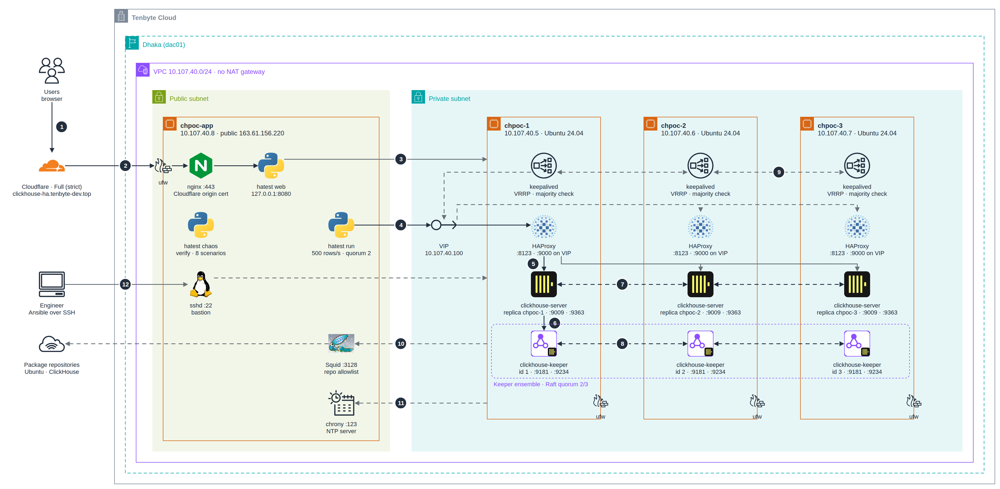

# ClickHouse HA Cluster

        

    

A three-node, highly available ClickHouse cluster on Tenbyte Cloud (Dhaka, dac01), deployed with Ansible and tested by deliberately breaking it. A test application writes continuously through every failure and proves afterwards that no acknowledged row was lost.

<a href="docs/diagrams/architecture-light.png">
<picture>
  <source media="(prefers-color-scheme: dark)" srcset="docs/diagrams/architecture-dark.png">
  
</picture>
</a>

## Result

All eight failure scenarios pass on the real VMs (Ubuntu 24.04, ClickHouse 26.8 LTS). The final verification found every one of 3,005,000 acknowledged rows on all three replicas, with identical checksums.

| # | What we broke | App write downtime | App read downtime | Rows lost |
|---|---|---|---|---|
| 1 | ClickHouse stopped on one node | 0.6 s | 0 s | 0 |
| 2 | `kill -9` on the node serving traffic | 0.9 s | 0 s | 0 |
| 3 | Keeper leader stopped | 0 s | 0 s | 0 |
| 4 | 2 of 3 Keepers stopped (quorum lost) | writes refused by design | 0 s | 0 |
| 5 | HAProxy stopped on the VIP owner | 2.8 s | 3.2 s | 0 |
| 6 | Hard reset of a whole VM (power cut) | 27.2 s | 7.8 s | 0 |
| 7 | One node network-partitioned | 31.6 s | 0 s | 0 |
| 8 | ClickHouse down on 2 of 3 nodes | writes refused by design | 0 s | 0 |

With client-side failover instead of the VIP, scenarios 1, 3 and 7 measured 0 s of downtime. Testing also produced twelve findings: eight defects that were fixed and re-tested, two facts about the environment, and two open follow-ups. See [results](docs/walkthrough/05-results.md).

The status page for the running cluster is at https://clickhouse-ha.tenbyte-dev.top (public, read-only).

## Walkthrough

0. [Overview: what HA means here and how a write works](docs/walkthrough/00-overview.md)
1. [Preparing the VMs: network, access, egress](docs/walkthrough/01-prepare-vms.md)
2. [Deploying with Ansible](docs/walkthrough/02-deploy.md)
3. [The test application and the status page](docs/walkthrough/03-test-app.md)
4. [The eight failure scenarios](docs/walkthrough/04-failure-scenarios.md)
5. [Results and findings](docs/walkthrough/05-results.md)
6. [Operating the cluster](docs/walkthrough/06-operations.md)
