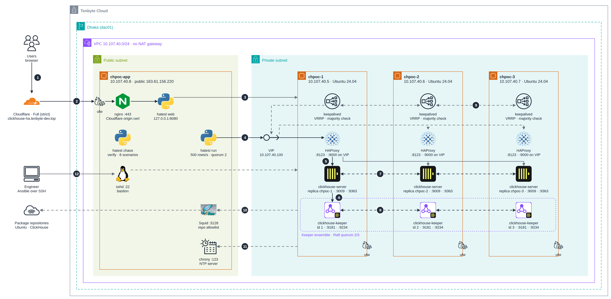
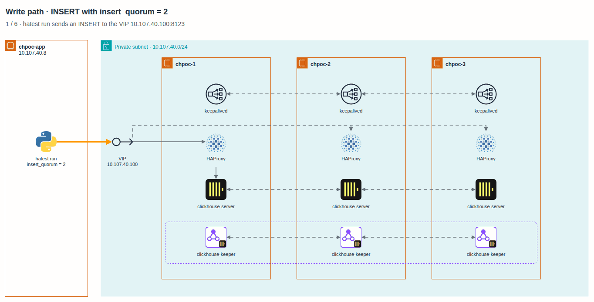
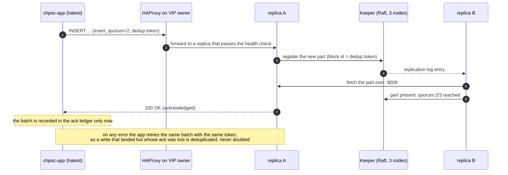

# 0. Overview

[README](../../README.md) · next: [1. Preparing the VMs](01-prepare-vms.md)

## What "highly available" means in this POC

The cluster keeps accepting reads and writes when any single component fails: one ClickHouse server, one Keeper, one HAProxy, one whole VM, or one node's network. When a second component fails at the same time, the cluster keeps serving reads and refuses writes it cannot make safe. It never loses a write it has acknowledged.

That last point is the one we test hardest. The test app records every INSERT the cluster acknowledged in a local ledger, and after each failure a verifier checks that every one of those rows exists on every replica.

## Architecture

<picture>
  <source media="(prefers-color-scheme: dark)" srcset="../diagrams/architecture-dark.png">
  
</picture>

1. Users open the status page; DNS for `clickhouse-ha.tenbyte-dev.top` is proxied by Cloudflare, with SSL mode Full (strict) for this hostname only.
2. Cloudflare connects to `chpoc-app` over TLS (Full strict, Cloudflare origin certificate). ufw accepts 80/443 only from Cloudflare's IP ranges; nginx proxies to `hatest web` on 127.0.0.1:8080.
3. `hatest web` (and the workload's monitor) polls every node directly on :8123 and Keeper :9181.
4. The workload sends SQL to the VIP 10.107.40.100:8123 with `insert_quorum = 2`.
5. HAProxy on the node that holds the VIP forwards each request to one of the three replicas that pass the query health check (leastconn). HAProxy on the other two nodes is bound to the VIP as well (dashed) and takes over the moment the VIP moves.
6. The replica registers the new block in the Keeper ensemble: three Keepers in one Raft group, used by every server (not only the one on its own node). Writes need 2 of the 3.
7. The other replicas fetch the new part over :9009 from whichever replica has it. Once two replicas hold it, the INSERT is acknowledged.
8. The Keepers replicate their log over Raft :9234.
9. keepalived on the three nodes exchanges VRRP (unicast, IP protocol 112). A node holds the VIP only while HAProxy runs on it and it can see a majority of the cluster.
10. The nodes have no internet access; apt goes through Squid :3128 on `chpoc-app`, which allows only the package repositories.
11. The nodes take time from chrony :123 on `chpoc-app`.
12. Engineers reach the private nodes only through the SSH bastion on `chpoc-app` (Ansible uses the same path). The chaos runner on `chpoc-app` reaches them on :22 with its own key.

| Piece | Choice | Why |
|---|---|---|
| Data | `ReplicatedMergeTree`, 1 shard × 3 replicas | every node holds all the data and can answer any query |
| Coordination | ClickHouse Keeper, its own systemd service on each node | a 3-node Raft group survives one failure; Keeper can fail independently of the server |
| Durability | `insert_quorum = 2` | an INSERT is acknowledged only once two replicas have it |
| Entry point | HAProxy on every node plus a keepalived floating VIP | one address for applications; health-checked routing |
| Split-brain guard | a node may hold the VIP only if it can see a majority of the cluster | an isolated node cannot pull traffic into a partition |
| Network | DB nodes have no public IP; `chpoc-app` is the only public host | the database is never reachable from the internet |
| Egress | Squid allowlist proxy and chrony on `chpoc-app` | the VPC has no NAT gateway; nodes still get packages and time |

## Names

Every VM uses one name everywhere: in the cloud console, as its hostname, as the SSH alias, in the Ansible inventory, as the ClickHouse replica name and in the test app.

| Name | Private IP | Role |
|---|---|---|
| `chpoc-1` | 10.107.40.5 | ClickHouse + Keeper (id 1) + HAProxy + keepalived |
| `chpoc-2` | 10.107.40.6 | ClickHouse + Keeper (id 2) + HAProxy + keepalived |
| `chpoc-3` | 10.107.40.7 | ClickHouse + Keeper (id 3) + HAProxy + keepalived |
| `chpoc-app` | 10.107.40.8, public 163.61.156.220 | test workload, status page, SSH jump host, egress proxy, NTP |
| `chpoc-vip` | 10.107.40.100 | floating IP, held by one healthy node at a time |

## How a write works

The third replica fetches the part asynchronously. By the time the verifier runs, all three hold identical data.

## Limits of this design

- It tolerates one failure. Losing two ClickHouse servers, or two Keepers, stops writes (reads continue). Tolerating two failures needs five nodes.
- There is one shard, so capacity is bounded by one node's disk and CPU. Scaling out means more shards, each with its own replicas, behind a `Distributed` table.
- The VIP needs layer-2 adjacency (all nodes in one subnet). Across subnets or zones, use a load balancer from the cloud or client-side failover.
