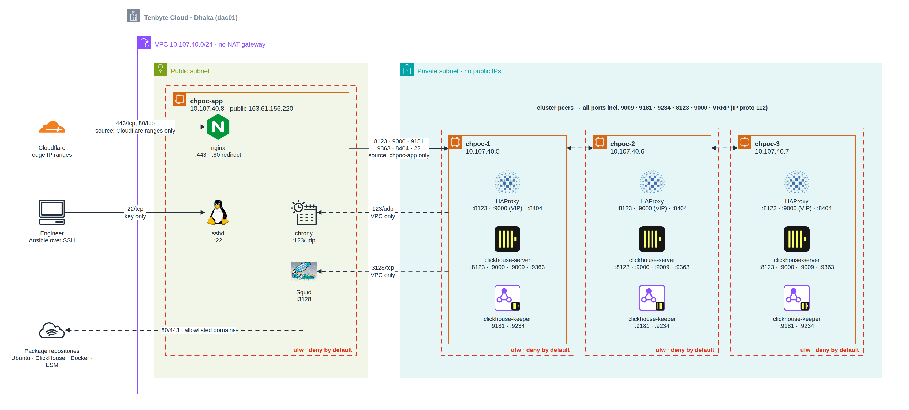

# 1. Preparing the VMs

[0. Overview](00-overview.md) · next: [2. Deploying](02-deploy.md)

## The VMs

Four VMs on Tenbyte Cloud in Dhaka (dac01), all in the VPC `10.107.40.0/24`, running Ubuntu 24.04.

| VM | Size used | Public IP |
|---|---|---|
| `chpoc-1`, `chpoc-2`, `chpoc-3` | 2 vCPU, 4 GB RAM, 30 GB disk | none (see the note on `chpoc-1` below) |
| `chpoc-app` | 2 vCPU, 2 GB RAM, 30 GB disk | 163.61.156.220 |

4 GB per database node was enough for this workload. For anything beyond a POC, use 4 vCPU and 8 GB or more. On 2 vCPUs, background merges and a full-table verification query noticeably slow a node.

`chpoc-1` was created with a public IP (163.61.156.216) by mistake. The host firewall blocks all traffic to it, and the logs show internet scanners hitting it and being dropped, but the IP should be removed from the VM.

## Why a fourth VM

The database nodes have no public address, so a laptop outside the cloud cannot reach them. `chpoc-app` is the one host with a public IP. It does five jobs:

1. SSH jump host for the engineers and for Ansible.
2. Runs the test workload inside the VPC, like a real application server, and on a machine that does not fail together with a database node.
3. Serves the status page through Cloudflare.
4. Egress proxy: the VPC has no NAT gateway, so VMs without a public IP cannot reach the internet at all. We found this when the first deploy failed with `apt-get update` timing out on `chpoc-2` and `chpoc-3`. Squid on `chpoc-app` forwards package downloads for an allowlist of domains only (Ubuntu archive and security, ESM, Docker, and `packages.clickhouse.com`).
5. NTP server: the nodes cannot reach public NTP either, and Raft and replication need synchronised clocks. chrony on `chpoc-app` serves time to the VPC.

## Access

The VMs were created with a username and password only. One bootstrap step, run once from the laptop, used the password to install our SSH key and passwordless sudo on all four VMs, going through `chpoc-app` to reach the private ones. Everything after that uses the key. The password is no longer needed and should be changed.

`~/.ssh/config` on the laptop:

```
Host chpoc-app
    HostName 163.61.156.220
    User chadmin
    IdentityFile ~/.ssh/tenbyte-poc
    IdentitiesOnly yes
Host chpoc-1
    HostName 10.107.40.5
Host chpoc-2
    HostName 10.107.40.6
Host chpoc-3
    HostName 10.107.40.7
Host chpoc-1 chpoc-2 chpoc-3
    User chadmin
    IdentityFile ~/.ssh/tenbyte-poc
    IdentitiesOnly yes
    ProxyJump chpoc-app
```

With that, `ssh chpoc-2` works from the laptop, and Ansible uses the same aliases.

The chaos tests run on `chpoc-app` and need to reach the nodes too. Ansible creates a separate key there (`~/.ssh/id_chpoc`) and authorises it on the three nodes, so the laptop key never leaves the laptop.

## Can the cloud carry a floating IP?

Many clouds silently drop traffic for an IP address that is not registered to a VM's port. We tested before building on it: we put `10.107.40.100` on `chpoc-1` and pinged it from the other VMs (reachable), then moved it to `chpoc-2`. The first attempt after the move failed from two VMs, because their ARP caches still pointed at `chpoc-1` and the announcement from `chpoc-2` had not gone out. After a gratuitous ARP it was reachable from everywhere. keepalived sends gratuitous ARPs on every takeover, so the VIP design works on this cloud.

## Network rules

<picture>
  <source media="(prefers-color-scheme: dark)" srcset="../diagrams/network-dark.png">
  
</picture>

Each red dashed frame is a host firewall (ufw, deny by default). Every arrow is an allowed flow, labelled with its ports and source restriction. Nothing in the private subnet has a public address; the only ways in are Cloudflare to nginx and SSH to the bastion.

The host firewall (ufw) is applied by Ansible on every VM. The cloud security groups can mirror it.

| From | To | Ports | Why |
|---|---|---|---|
| internet | `chpoc-app` | 22/tcp | SSH, key only |
| Cloudflare IP ranges | `chpoc-app` | 80, 443/tcp | status page; the ranges are fetched from cloudflare.com at deploy time |
| DB nodes ↔ DB nodes | all | all, including VRRP (IP protocol 112) | replication :9009, Keeper :9181 and Raft :9234, HAProxy checks :8123, VRRP |
| `chpoc-app` | DB nodes, VIP | 8123, 9000, 9181, 9363, 8404/tcp | workload, monitoring, metrics, HAProxy stats |
| DB nodes | `chpoc-app` | 3128/tcp, 123/udp | package proxy, NTP |
| everything else | anywhere | none | denied |

Nothing on the database nodes is reachable from the internet. The status page is only reachable through Cloudflare; a direct request to 163.61.156.220 on ports 80 and 443 is refused.
