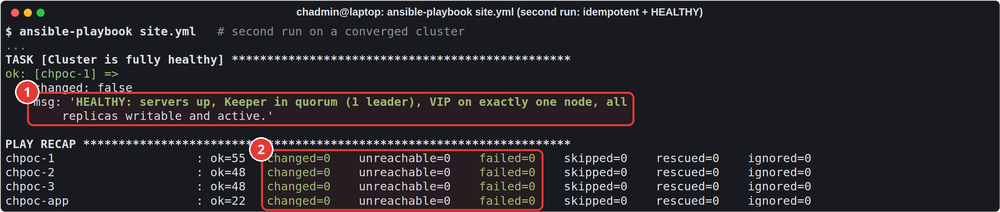
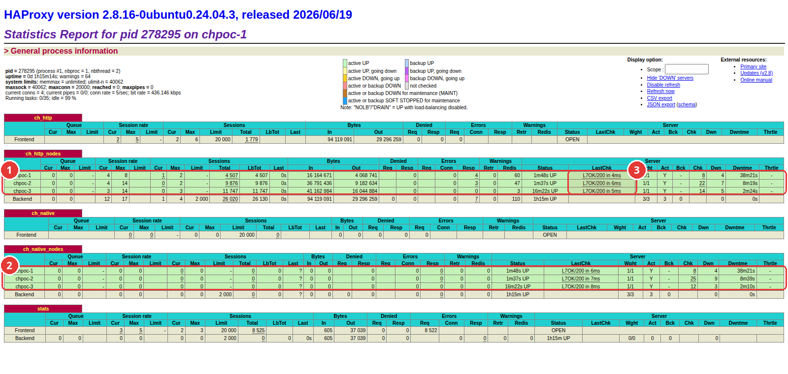
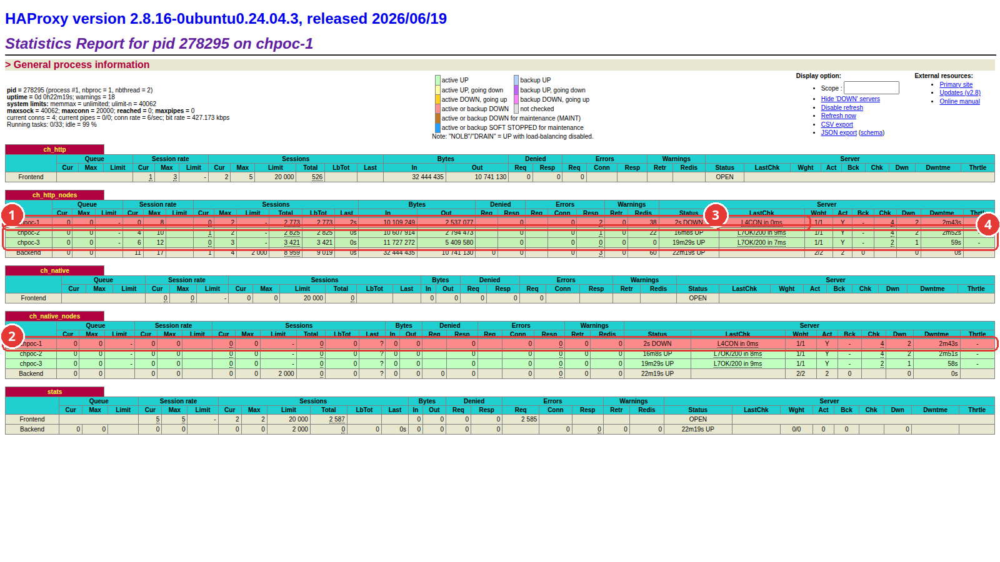

# 2. Deploying with Ansible

[1. Preparing the VMs](01-prepare-vms.md) · next: [3. The test application](03-test-app.md)

Everything runs from the laptop. Nothing is installed by hand on the VMs.

## Tooling

```bash
python3 -m venv .venv && .venv/bin/pip install ansible-core passlib
cd ansible
../.venv/bin/ansible-galaxy collection install -r requirements.yml
```

## Configuration

`ansible/inventory.ini` lists the nodes by their SSH alias, private IP and Keeper id:

```ini
[clickhouse]
chpoc-1 ansible_host=chpoc-1 private_ip=10.107.40.5 keeper_id=1
chpoc-2 ansible_host=chpoc-2 private_ip=10.107.40.6 keeper_id=2
chpoc-3 ansible_host=chpoc-3 private_ip=10.107.40.7 keeper_id=3

[client]
chpoc-app ansible_host=chpoc-app private_ip=10.107.40.8
```

`ansible/group_vars/all/main.yml` holds everything else: the ClickHouse channel (`lts`), the VIP (`10.107.40.100/24`), who may connect (`client_cidrs`), the egress allowlist and the status page hostname. Each setting has a comment explaining it.

Secrets live in `ansible/group_vars/all/vault.yml`, encrypted with Ansible Vault:

- passwords for the `default`, `admin` and `app` ClickHouse users (stored on the servers as SHA-256 hashes),
- the interserver replication credentials and the cluster secret,
- the VRRP password,
- the status page password,
- the Cloudflare origin certificate and its private key.

They were generated with a random generator and never typed or shown in plain text. The vault key is in `~/.chpoc-vault-pass` on the laptop, outside the repository, and `ansible.cfg` points to it, so runs need no prompt. The vault file itself is excluded from git.

To read one value, for example the status page password:

```bash
cd ansible && ../.venv/bin/ansible localhost -m debug -a "msg={{ vault_web_password }}"
```

## Running the deployment

```bash
cd ansible && ../.venv/bin/ansible-playbook site.yml
```

`site.yml` runs these plays in order:

| Play | What it does |
|---|---|
| Egress gateway (`chpoc-app`) | Squid with the domain allowlist, chrony as NTP server, ufw |
| ClickHouse nodes | apt through the proxy, chrony from `chpoc-app`, sysctl and limits, transparent huge pages set to `madvise`, ufw; ClickHouse packages from the official repo, pinned and held; Keeper as its own systemd unit (waits for the 3-node quorum); server config: cluster, macros, Keeper, interserver auth, users, durability settings, a 5 s restart-on-crash drop-in |
| Load balancer | HAProxy bound on the VIP on every node; keepalived with the majority check |
| Schema | `poc.events`, `poc.events_all` (Distributed) and `poc.probe`, created `ON CLUSTER` |
| Application host | the `hatest` app with its own virtualenv, the chaos SSH key, the status page (nginx, origin certificate, login, Cloudflare-only firewall) |
| Health | the report below, and an assert that fails the run unless everything is healthy |

The health play checks each node directly and fails the whole run unless all servers are up, Keeper has exactly one leader, the VIP is on exactly one node and every replica is writable:



1. The health playbook's final assert: every server is up, Keeper has a quorum with exactly one leader, the VIP is on exactly one node, and every replica is writable.
2. Second run on the converged cluster: `changed=0` and `failed=0` on all four hosts. The deployment is idempotent.

Getting there took four attempts on day one, and each failure led to a fix in the roles:

1. `apt-get update` timed out on the private nodes: there is no NAT gateway. Fixed with the egress proxy and NTP on `chpoc-app`.
2. Squid refused its own config: `.archive.ubuntu.com` already covers `archive.ubuntu.com`, and listing both is an error. The `validate:` step caught it before Squid reloaded.
3. apt still failed through the proxy: the cloud image has Docker and Ubuntu Pro (ESM) apt sources, and the allowlist blocked them. Both were added.
4. The deployment succeeded, and a second run changed two tasks: a oneshot systemd unit without `RemainAfterExit=yes`, and our limits file colliding with the one `clickhouse install` writes. Both were fixed; the third run reported `changed=0` everywhere.

## HAProxy

Each node's HAProxy statistics page (port 8404, reachable from inside the VPC) shows the backend state. Healthy:



1. All three nodes are UP in the HTTP backend (:8123)...
2. ...and in the native-protocol backend (:9000).
3. `L7OK/200`: the query-based health check succeeds on every node.

And during scenario 1, with ClickHouse stopped on `chpoc-1`:



1. `chpoc-1` was just stopped (scenario 1): HAProxy has marked it DOWN in the HTTP backend...
2. ...and in the native-protocol backend. Its open sessions were cut so clients reconnect elsewhere.
3. Reason: `L4CON`, connection refused on the health check.
4. `chpoc-2` and `chpoc-3` stay UP and carry all the traffic.

The health check is a real query, `SELECT 1 FROM poc.events WHERE 0`, run as a `healthcheck` user that may only read that table and only from the cluster nodes. The first version used `/ping`, which only proves the process is alive; chaos testing showed why that is not enough (finding 4 in [results](05-results.md)).

## Changing configuration later

A plain `site.yml` run restarts every node whose config changed, which on a live cluster could restart all three at once. Apply changes one node at a time instead:

```bash
for n in chpoc-1 chpoc-2 chpoc-3; do ../.venv/bin/ansible-playbook site.yml --limit $n || break; done
```

Each run restarts only that node and waits until it is healthy before the next one starts. The durability and health-check changes in this POC were rolled out this way while the workload kept running.
