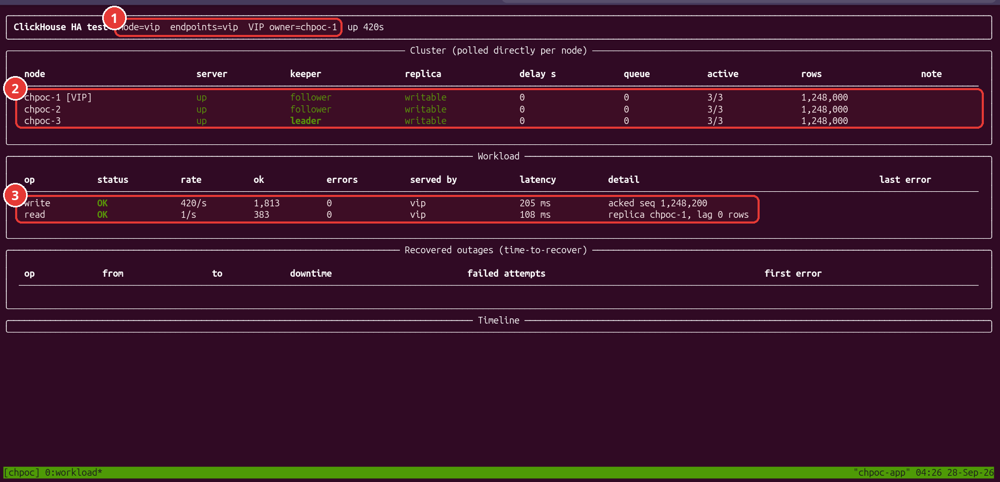
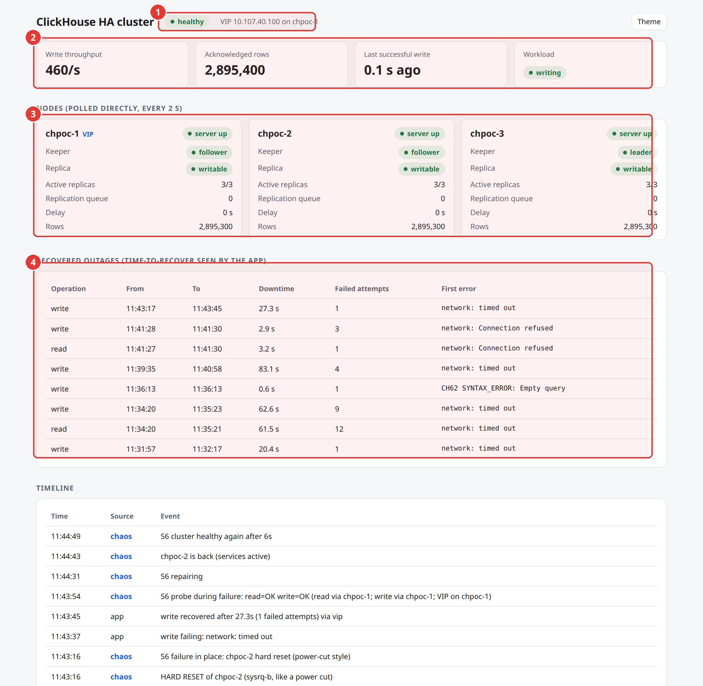
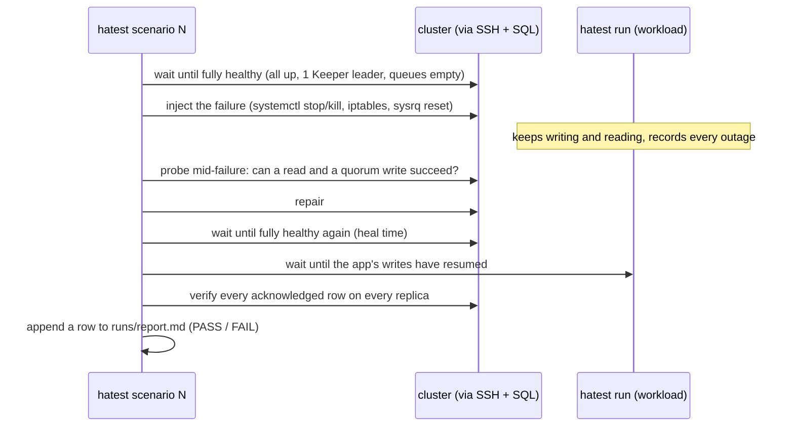

# 3. The test application and the status page

[2. Deploying](02-deploy.md) · next: [4. Failure scenarios](04-failure-scenarios.md)

`app/` is a small Python package, `hatest`, installed on `chpoc-app` with a `hatest` command on the path. It has five parts.

| Command | What it does |
|---|---|
| `hatest run` | the workload: continuous writes and reads, plus a live terminal dashboard |
| `hatest verify` | the zero-loss check against every replica |
| `hatest scenario 1..8 \| all` | automated failure scenarios, each one self-checking |
| `hatest chaos <action> <node>` | manual fault injection for live demos |
| `hatest web` | the read-only status page behind nginx |

## How the zero-loss proof works

The writer inserts 100 rows per batch, 5 batches per second, each row carrying a sequence number. Every INSERT uses `insert_quorum = 2` and an explicit `insert_deduplication_token` equal to the batch's first sequence number.

A batch goes into a local SQLite ledger (`runs/ledger.sqlite`) only after ClickHouse acknowledges it. If an INSERT fails for any reason (timeout, connection reset, quorum not reached), the writer retries the same batch with the same token until it succeeds. If an earlier attempt had in fact been written, ClickHouse recognises the token and drops the retry. Retries therefore never create duplicates, and the ledger contains exactly the set of rows the cluster promised to keep.

`hatest verify` then connects to each replica directly, not through the VIP, and checks:

- every acknowledged batch is present in full on that replica,
- no sequence number appears twice,
- the checksum `sum(cityHash64(*))` over the acknowledged range is identical on all replicas.

Replication after the quorum is asynchronous, so verify waits (up to a timeout) for each replica to catch up and converge before it judges. A replica that is still missing rows or disagrees after that fails the check.

"Unacknowledged extra batches" are rows that reached the cluster although the client never got the acknowledgement, because the connection died mid-request. They are reported but are not a loss.

## Two ways to fail over

`hatest run --mode vip` sends everything to the VIP, and HAProxy and keepalived handle failover. `hatest run --mode client` gives the app the list of all three nodes: it sticks to one and moves to the next on any error. Both modes were tested; see [results](05-results.md) for the difference.

## The terminal dashboard

```bash
ssh -t chpoc-app tmux attach -t chpoc      # or: ssh chpoc-app, then hatest run
```



1. Workload mode (through the VIP) and the node currently holding the VIP.
2. Polled directly on every node: server up, one Keeper leader and two followers, all replicas writable, 3/3 active, identical row counts.
3. The workload: about 420 to 500 rows/s of quorum writes plus a read every second, 0 errors, served via the VIP.

Below the workload panel, "Recovered outages" lists every period in which writes or reads failed, with the measured time-to-recover (from the last success before the failure to the first success after it). The timeline shows what the chaos runner did and when.

## The status page

https://clickhouse-ha.tenbyte-dev.top shows the same data in a browser, for people who do not have SSH access. It is public and read-only: it shows node names, private IPs, row counts and the test timeline, and gives no access to the database. If it ever needs to be private again, Cloudflare Access can be put in front of it without changing the server.



1. Overall health and which node holds the VIP.
2. Live workload KPIs: throughput, acknowledged rows, time since the last successful write.
3. One card per node, polled directly: server, Keeper role, replica state, replication queue, rows.
4. Outages the app experienced, with measured time-to-recover.

Browser times are local (Dhaka, UTC+6); the terminal screenshots show UTC.

How it is published:

```
browser → Cloudflare (TLS, proxied DNS) → nginx :443 on chpoc-app (Cloudflare origin certificate)
        → hatest web on 127.0.0.1:8080 → polls the nodes over the private network
```

- The Cloudflare SSL mode for this hostname is Full (strict), set with a configuration rule that applies to `clickhouse-ha.tenbyte-dev.top` only, so other sites on the zone keep their own settings.
- ufw on `chpoc-app` accepts 80 and 443 only from Cloudflare's published IP ranges.
- nginx drops requests for any other hostname.

Tested from outside: the page returns 200 through Cloudflare, and a direct request to 163.61.156.220 on port 80 or 443 is refused.

## The scenario runner



If the runner itself hits an error while injecting or repairing a failure, it starts every service on every node and heals any partition before reporting, so a failed test cannot leave the cluster broken. This was added after a real case where a slow `systemctl stop` timed out and left `chpoc-1` stopped for 30 minutes (finding 8 in [results](05-results.md)).
