# 4. The eight failure scenarios

[3. The test application](03-test-app.md) · next: [5. Results](05-results.md)

Each scenario ran on the real VMs with the workload writing about 500 rows/s through the VIP. "Write downtime" and "read downtime" are the longest gaps the app itself saw between two successful operations. "Heal time" is the time from the repair until every node was up, Keeper had a leader and every replication queue was empty. All numbers come from [`docs/results/report-vip-mode-final.md`](../results/report-vip-mode-final.md).

```bash
ssh chpoc-app
hatest scenario all          # or: hatest scenario 3, hatest scenario 6 --node chpoc-3
```

The screenshots were captured at the moment each failure was in place (terminal times are UTC).

## Scenario 1: ClickHouse stopped on one node

`systemctl stop clickhouse-server` on `chpoc-1`.

Expected: HAProxy marks the node down after two failed checks (about 4 s) and the other replicas carry on. When the node comes back it fetches the parts it missed.

Measured: write downtime 0.6 s (one request in flight during the stop), read downtime 0 s, heal 28 s, 0 rows lost.

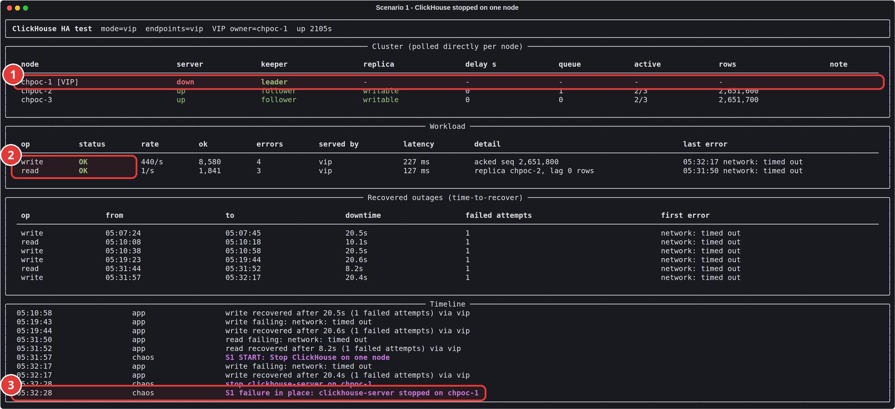

1. ClickHouse stopped on `chpoc-1`: server down; the other two replicas report 2/3 active.
2. Writes and reads stay OK: HAProxy routes around the dead node.
3. The chaos runner's log line: the failure is in place.

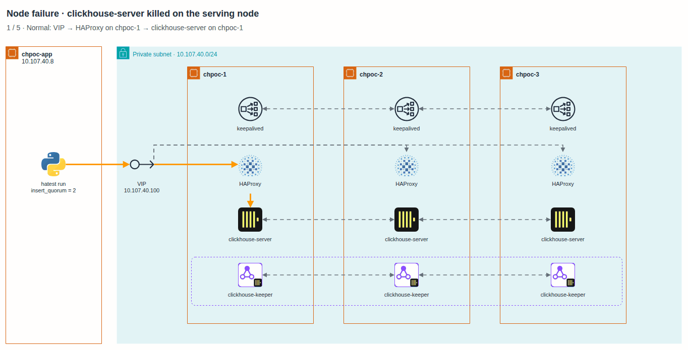

## Scenario 2: kill -9 on the node serving traffic

`kill -9` on the ClickHouse process of the node answering the app, found through the VIP, which was `chpoc-2` at the time.

Expected: in-flight requests fail and are retried on another node. systemd restarts the process on its own.

Measured: write downtime 0.9 s, read 0 s, heal 3 s, 0 rows lost.

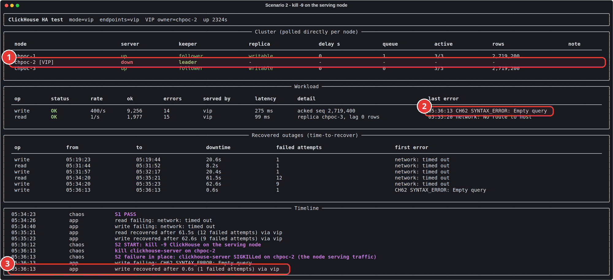

1. `chpoc-2` (holding the VIP) was killed with `kill -9` while serving traffic.
2. The one in-flight INSERT broke mid-request ("Empty query")...
3. ...and was retried with the same dedup token: recovered after 0.6 s, no duplicate, no loss. systemd restarts the server within 5 s.

The package's default restart delay is 30 s; a drop-in sets it to 5 s (finding 2).

## Scenario 3: Keeper leader stopped

`systemctl stop clickhouse-keeper` on whichever node is the Raft leader.

Expected: the two survivors still form a majority and elect a new leader within seconds.

Measured: a new leader was elected in 2 s. Write downtime 0 s, read 0 s, heal 3 s, 0 rows lost.

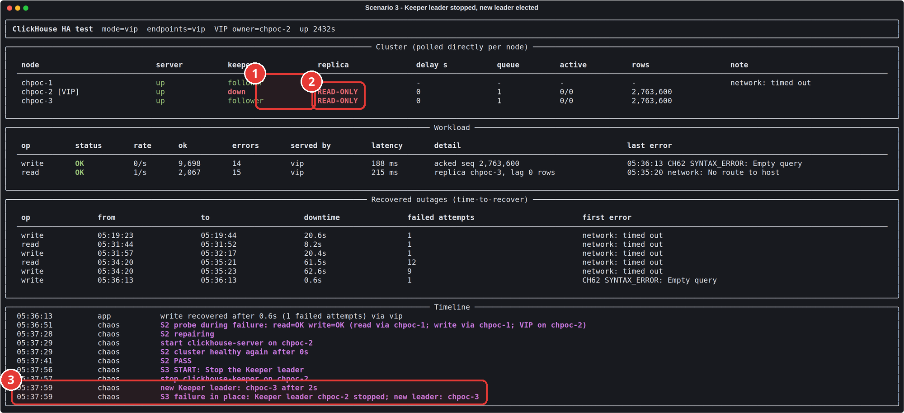

1. Keeper leader `chpoc-2` stopped; `chpoc-3` became the new leader within 2 s.
2. Replicas are briefly READ-ONLY while they reconnect to the new leader.
3. Timeline: leader stopped, new leader elected.

## Scenario 4: Keeper quorum lost (2 of 3 Keepers down)

`systemctl stop clickhouse-keeper` on the leader and one follower.

Expected: with one Keeper left there is no majority. The tables go read-only: reads continue and writes are refused, because accepting them without coordination could lose or duplicate data. When a second Keeper returns, writes resume.

Measured: the probe during the failure confirmed reads OK and writes refused. Writes were unavailable for 83 s, which is the whole time the failure was held plus recovery. Read downtime 0 s, heal 9 s, 0 rows lost.

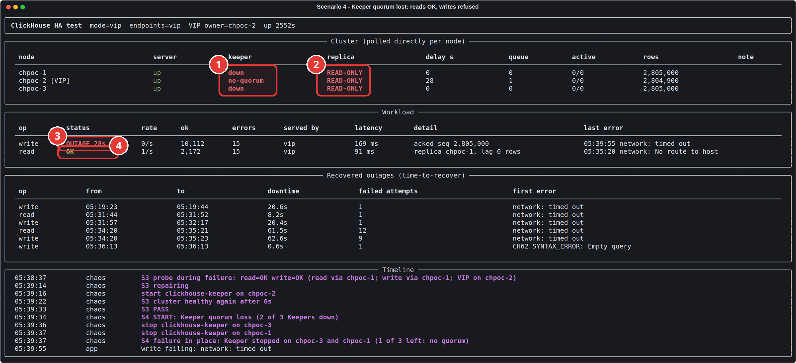

1. 2 of 3 Keepers are down; the survivor has no quorum.
2. Every replica is READ-ONLY: the cluster refuses changes it cannot coordinate safely.
3. Writes are in OUTAGE: refused by design...
4. ...while reads keep working.

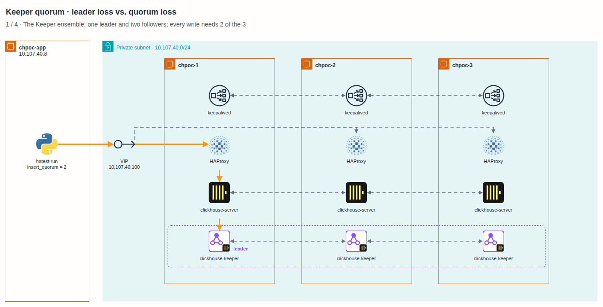

The first run of this scenario was marked FAIL, and it was the verifier's mistake. One INSERT's commit status was unknown when Keeper vanished, which left an orphaned copy of that batch on `chpoc-1`. When Keeper came back, `chpoc-1` reconciled with it and removed the copy about 13 s later. The verifier had checked during that window. It now waits for replicas to converge before judging, and the re-run passed (finding 9).

## Scenario 5: HAProxy stopped on the VIP owner

`systemctl stop haproxy` on the node holding the VIP.

Expected: keepalived's check fails, the node releases the VIP and another node takes it within a few seconds.

Measured: the VIP moved from `chpoc-2` to `chpoc-1` in about 2 s. Write downtime 2.8 s, read 3.2 s, heal 6 s, 0 rows lost.

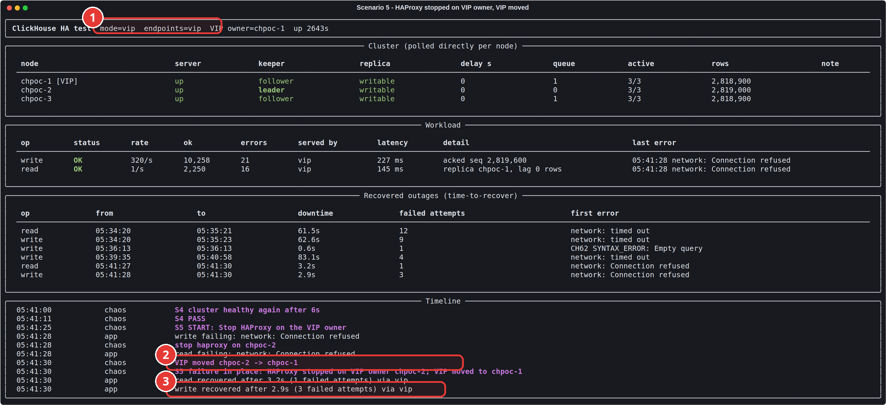

1. The VIP now lives on `chpoc-1`.
2. HAProxy was stopped on the old VIP owner `chpoc-2`, and keepalived moved the VIP within about 2 s.
3. The app reconnected through the VIP: writes recovered after 2.9 s.

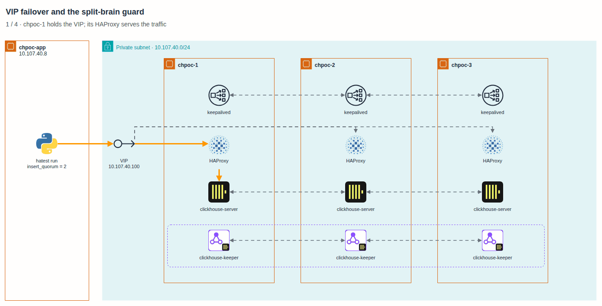

The VIP does not move back when the node recovers (keepalived `nopreempt`). Moving it back would cause a second, unnecessary interruption.

## Scenario 6: hard reset of a whole VM

`echo b > /proc/sysrq-trigger` on `chpoc-2`: an immediate reboot with no shutdown and no disk sync, the closest thing to pulling the power cord.

Expected: the server and the Keeper on that node are lost at once, the other two keep serving, and the node rejoins by itself after boot.

Measured: write downtime 27.2 s, read 7.8 s, heal 3 s after the VM was back (about 50 s to reboot), 0 rows lost.

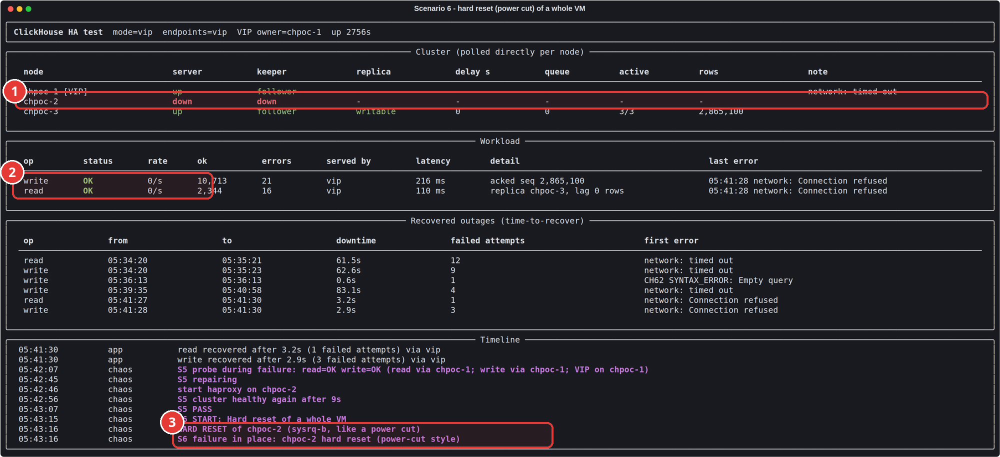

1. `chpoc-2` hard-reset (sysrq-b, like a power cut): server and Keeper gone at once.
2. The workload stays OK on the other two nodes.
3. Timeline of the reset. The node rebooted, repaired its broken parts from its peers and rejoined by itself.

This scenario failed twice on day one. After the reset, `chpoc-2` refused to load the table, because more than 100 recently written parts were empty on disk. Recovery needed an operator. The cause and the fix are finding 3 in [results](05-results.md). The final run passed with no manual step.

The 27 s of write downtime is longer than in scenario 1 for two reasons. First, a VM that loses power does not refuse connections the way a stopped process does; it just goes silent, so requests time out instead of failing fast. Second, one Keeper disappeared along with the server, and ClickHouse sessions on that Keeper had to reconnect.

## Scenario 7: one node network-partitioned

iptables on one node drops all traffic to and from the other two nodes. SSH from `chpoc-app` still works, so the test can heal it, and a systemd timer on the node removes the rules by itself after a safety delay.

Expected: the isolated node loses its Keeper quorum and turns read-only instead of diverging. The majority side keeps serving. The isolated node must not claim the VIP.

Measured: write downtime 31.6 s, read 0 s, heal 21 s after the partition was lifted, 0 rows lost. The VIP stayed on the majority side.

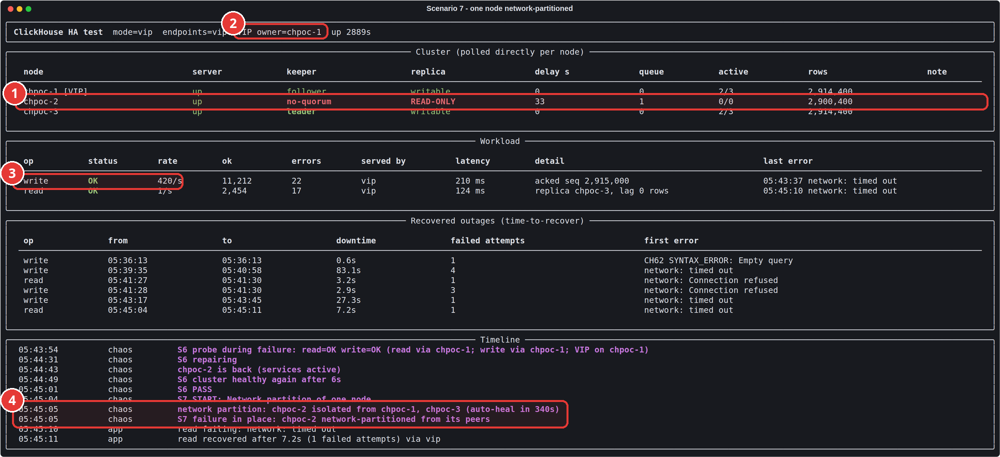

1. Isolated `chpoc-2`: Keeper has no quorum, replica READ-ONLY, row count frozen. It stops accepting writes instead of diverging.
2. The VIP stays on the majority side: the split-brain guard kept the isolated node from claiming it.
3. Writes continue at full rate on the majority (`chpoc-1` + `chpoc-3`).
4. The partition is applied with iptables, with an automatic heal as a safety net.

On day one this scenario exposed a split-brain race. The isolated node declared itself VRRP master 3 s into the partition, but its majority check only failed 4 s later. In between it announced the VIP's MAC address to the network, and traffic for the VIP went into the partition for 54 s. The fix is finding 5.

## Scenario 8: ClickHouse down on 2 of 3 nodes

`systemctl stop clickhouse-server` on two nodes.

Expected: reads are served by the last node. Writes are refused, because `insert_quorum = 2` cannot be met with one replica: the cluster will not acknowledge a write that exists in only one place.

Measured: the probe confirmed reads OK and writes refused with `TOO_FEW_LIVE_REPLICAS`. Writes were unavailable for 69.4 s, until the servers came back. Read downtime 0 s, heal 3 s, 0 rows lost.

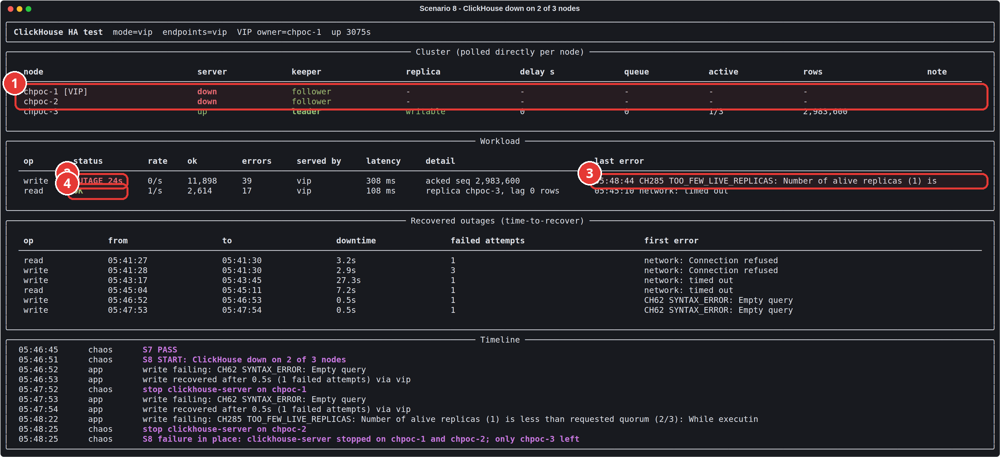

1. ClickHouse is down on `chpoc-1` and `chpoc-2`; only `chpoc-3` is left (1/3 active).
2. Writes in OUTAGE, by design...
3. ...because `insert_quorum=2` cannot be met: `TOO_FEW_LIVE_REPLICAS`. Nothing is accepted without a second copy.
4. Reads are still served by `chpoc-3`.

This is the limit of a three-node design, and it behaves the way it should.

## After all eight

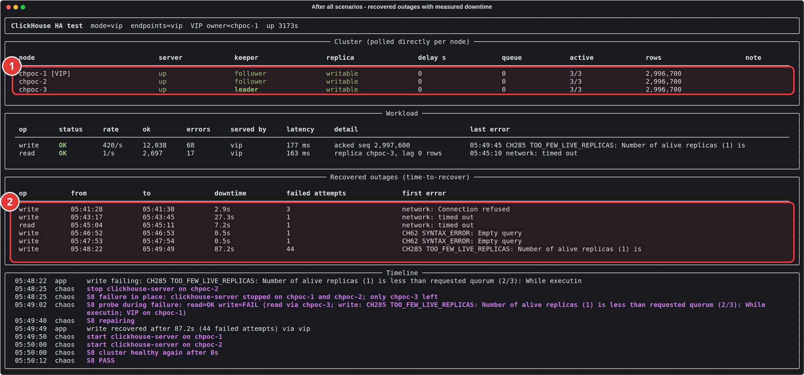

1. After all eight scenarios, the cluster is back to fully healthy, with identical row counts on every replica.
2. Every outage the app saw, with its measured time-to-recover and first error.
