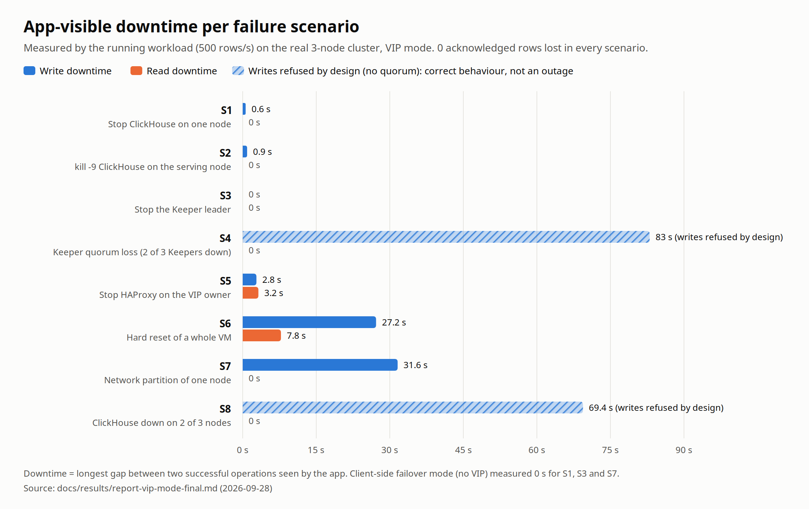
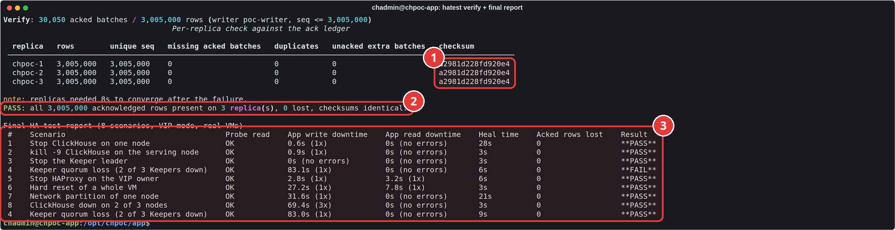

# 5. Results and findings

[4. Failure scenarios](04-failure-scenarios.md) · next: [6. Operating the cluster](06-operations.md)

## Downtime per scenario

<picture>
  <source media="(prefers-color-scheme: dark)" srcset="../diagrams/downtime-by-scenario-dark.png">
  
</picture>

| # | Scenario | Write downtime | Read downtime | Heal time | Acked rows lost | Result |
|---|---|---|---|---|---|---|
| 1 | ClickHouse stopped on one node | 0.6 s | 0 s | 28 s | 0 | PASS |
| 2 | `kill -9` on the serving node | 0.9 s | 0 s | 3 s | 0 | PASS |
| 3 | Keeper leader stopped | 0 s | 0 s | 3 s | 0 | PASS |
| 4 | Keeper quorum lost | 83.0 s, refused by design | 0 s | 9 s | 0 | PASS |
| 5 | HAProxy stopped on the VIP owner | 2.8 s | 3.2 s | 6 s | 0 | PASS |
| 6 | Hard reset of a VM | 27.2 s | 7.8 s | 3 s | 0 | PASS |
| 7 | Network partition of one node | 31.6 s | 0 s | 21 s | 0 | PASS |
| 8 | ClickHouse down on 2 of 3 nodes | 69.4 s, refused by design | 0 s | 3 s | 0 | PASS |

Raw reports: [final VIP-mode run](../results/report-vip-mode-final.md), [the run the screenshots come from](../results/report-vip-mode-screenshot-run.md), [client mode](../results/report-client-mode.md), [day one, with the failures that led to the fixes](../results/report-day1-findings.md).

## Zero-loss proof

1. Identical checksums on all three replicas.
2. Zero-loss proof: every row the cluster ever acknowledged (3,005,000) is present on every replica.
3. The final report: all 8 scenarios on real VMs, with measured downtime, heal time and acknowledged rows lost (0 everywhere). S4's first FAIL was the verifier running before replicas converged; the re-run below it passes.

Over both days the workload wrote more than 3.1 million acknowledged rows through every failure listed here, plus a few that were not planned. The verifier never found one missing.

## VIP mode compared with client-side failover

| Scenario | VIP mode (write / read) | Client mode (write / read) |
|---|---|---|
| 1. ClickHouse stopped | 0.6 s / 0 s | 0 s / 0 s |
| 3. Keeper leader stopped | 0 s / 0 s | 0 s / 0 s |
| 7. Network partition | 31.6 s / 0 s | 0 s / 0 s |

In client mode the app knows all three nodes and retries the next one immediately on any error. The VIP path has to wait for HAProxy's health checks (2 × 2 s) and, in some failures, for the VIP to move. A client with the node list is faster. The VIP is simpler, for tools and people that cannot be given a node list. Production applications should use a failover-aware client (most ClickHouse drivers accept several hosts) and keep the VIP for everything else.

## Findings

Testing on real VMs turned up these twelve. Each one is written up with what happened, why, and what we changed.

### 1. The private nodes had no internet access

The VPC has no NAT gateway, so `apt-get update` timed out on `chpoc-2` and `chpoc-3`. Fix: `chpoc-app` runs a Squid proxy with a domain allowlist and a chrony NTP server. The nodes still cannot reach the internet directly. (role `egress_gateway`)

### 2. `systemctl kill -s SIGKILL` fails on Ubuntu 24.04 for clickhouse-server

ClickHouse runs a watchdog parent process, and systemd returns "Invalid argument" when it signals the auxiliary process. Also, the package restarts a crashed server only after 30 s. Fix: the chaos runner sends `kill -9` to the main PID, and a systemd drop-in sets `RestartSec=5`.

### 3. After a power cut, a replica refused to start its table

A hard reset left 150 to 370 recently written parts with zero-byte files, because their data was still in the kernel's page cache. ClickHouse detaches broken parts and fetches them again from the other replicas, but only up to `max_suspicious_broken_parts` (default 100). Above that it refuses to load the table and waits for an operator. `fsync_after_insert` alone did not help: most parts on a replica arrive by fetch or merge, and those are not fsynced. Fix: `max_suspicious_broken_parts = 1000`, while `max_suspicious_broken_parts_bytes` stays at 1 GiB. The byte limit is the guard that matters against a real disaster such as a wrong or corrupted disk, and the parts broken by a crash total about 0 bytes. `fsync_after_insert` stays on, so the replica that acknowledges an INSERT has it on disk. With this the node heals itself after a power cut (scenario 6 passed with no manual step). (template `45-durability.xml`)

### 4. HAProxy kept sending reads to a node that could not serve them

While the table on `chpoc-2` was not loaded (finding 3), `/ping` still answered, because the process was running. The result was 79 failed reads. Fix: the health check runs `SELECT 1 FROM poc.events WHERE 0` as a least-privilege `healthcheck` user. A node that cannot serve the table leaves the pool, while a read-only replica still answers and stays in it for reads.

### 5. VIP split-brain race during a partition

The isolated node declared itself VRRP master 3 s into the partition (it no longer heard the adverts), but its majority check was only failing 7 s in. In between it sent gratuitous ARPs for the VIP, and clients sent VIP traffic into the partition for 54 s. Fix: the eligibility check runs every second and probes the peers in parallel, so it fails before the VRRP takeover timer (about 3.6 s). The real master also re-announces the VIP every 5 s (`garp_master_refresh`), which corrects any stray announcement within 5 s. The final run of scenario 7 kept the VIP on the majority side.

### 6. The cloud network dropped all new connections between the VMs for about 55 s

From 05:34:20 to 05:35:15 UTC on 2026-09-28, with no test running, every node's HAProxy lost new TCP connections to both other nodes ("Layer4 timeout"). Established connections, such as Keeper's Raft links, kept working for about 50 s longer, and traffic from the internet still arrived. That combination points to the provider's virtual network. The cluster did the safe thing: no node could see a majority, so all three released the VIP, and everything recovered by itself with 0 rows lost. The provider should be asked whether their virtual network had an event in that window.

### 7. A cluster running on two nodes is slower

With one node down, `insert_quorum = 2` needs both survivors to confirm every write, so any hiccup on either one stalls writes up to the 15 s quorum timeout. We saw several 20 s write stalls during the half hour a node was accidentally left stopped. No data was lost, but the rule is to restore a failed node promptly and not run degraded.

### 8. A graceful ClickHouse stop can take about 60 s

The server waits for open client connections, and idle HTTP keep-alive connections from HAProxy and the monitor held it up. At 60 s systemd killed it. Our chaos runner timed out at 60 s and left `chpoc-1` stopped. Fix: 180 s timeouts in the runner, and on any error the runner restarts every service and heals any partition before reporting. Lowering `keep_alive_timeout` would shorten the stop.

### 9. Replicas need a few seconds to agree after a Keeper outage

An INSERT whose commit status was unknown when Keeper vanished left an orphaned copy of one batch on a replica. The replica removed it about 13 s after Keeper came back. Fix: the verifier waits for convergence (and reports how long it took) before it judges.

### 10. nginx 1.24 on Ubuntu 24.04 does not know `http2 on;`

That directive needs nginx 1.25.1 or later. The config validation caught it before any reload; we use `listen 443 ssl http2;` instead.

### 11. rsyslog's AppArmor profile blocks HAProxy's log socket inside its chroot

Some HAProxy alerts, such as "server is DOWN", are dropped from syslog. This has no effect on HAProxy itself. A small AppArmor local override or logging outside the chroot fixes it; it is left as a follow-up.

### 12. `chpoc-1` has a public IP

It was ticked by mistake when the VM was created. ufw blocks everything, and the logs show internet scanners being dropped, but the IP should be removed in the cloud console.

## Recommendations for production

- Size the database nodes at 4 vCPU and 8 GB or more. At 2 vCPU, merges and verification queries push the load high enough to slow everything else on the node.
- Use a failover-aware client with all node addresses. Keep the VIP for other clients.
- Add monitoring and alerting. The data is already exposed: Prometheus metrics on :9363, `system.replicas`, and Keeper's `mntr`. Alert on read-only replicas, replication queue size, Keeper leader changes and nodes missing from HAProxy.
- Add backups. Replication protects against losing a machine, not against a bad `DROP` or `ALTER`. ClickHouse `BACKUP ... TO S3` or disk is the next step.
- Add TLS inside the VPC, for client ports, interserver replication and Keeper.
- To survive two simultaneous failures, move to five nodes.
- Change the VM password that was shared during setup, and turn off SSH password logins now that key access is in place.
